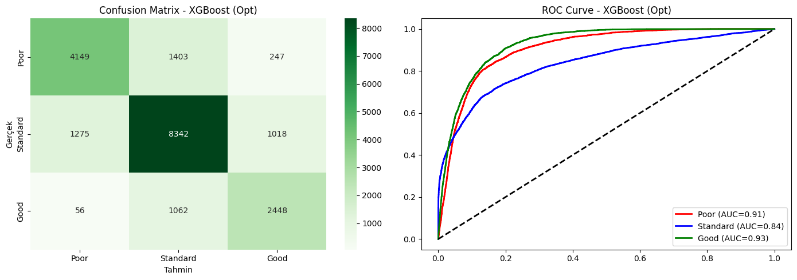
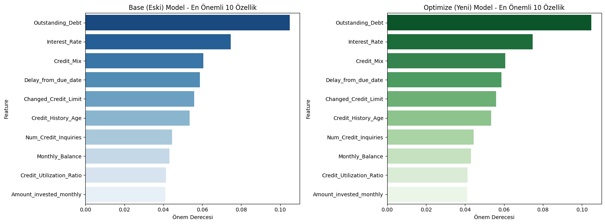
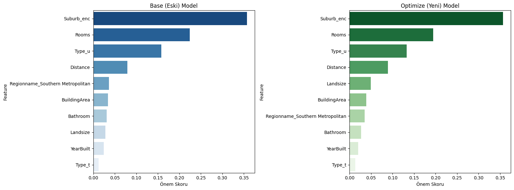
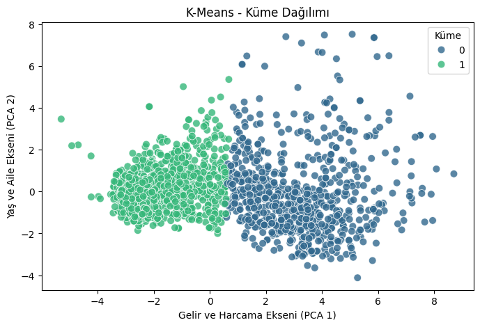
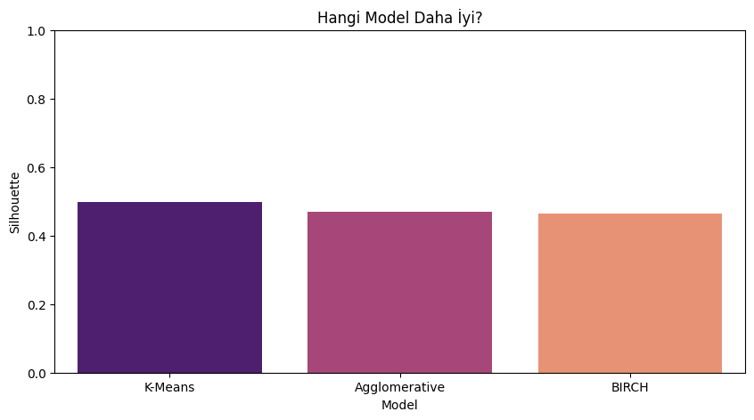

# 📊 Machine Learning Term Project — Classification, Regression & Clustering

Three end-to-end machine learning pipelines on real-world tabular datasets. Each one covers data cleaning, outlier handling, feature engineering, a comparison of three algorithms, hyperparameter tuning with **GridSearchCV**, and training-time measurements.

Term project for the *Machine Learning* course at Balıkesir University (Fall 2025). Hardware: AMD Ryzen 7 5700X, 16 GB DDR4, RTX 3060 Ti.

| Task | Dataset | Best model | Result |
|---|---|---|---|
| [Classification](#1-classification--credit-score-prediction) | [Credit Score Classification](https://www.kaggle.com/datasets/parisrohan/credit-score-classification) (100,000 rows) | Random Forest | **78.8 % accuracy**, ROC-AUC 0.89 |
| [Regression](#2-regression--melbourne-house-prices) | [Property Sales of Melbourne City](https://www.kaggle.com/datasets/amalab182/property-salesmelbourne-city) (18,396 rows) | Gradient Boosting (tuned) | **R² 0.79** |
| [Clustering](#3-clustering--customer-segmentation) | [Customer Segmentation](https://www.kaggle.com/datasets/vishakhdapat/customer-segmentation-clustering) (2,240 customers) | K-Means | **Silhouette 0.50** |

---

## 1. Classification — Credit Score Prediction

Predict a customer's credit score class (**Poor / Standard / Good**) from 23 financial features.

**Preprocessing**
- Dropped identifier columns (ID, Customer_ID, Name, SSN)
- Cleaned corrupted numeric values (e.g. `"_"` characters inside numbers)
- Converted `Credit_History_Age` from "22 Years and 1 Months" into a number of months
- Capped outliers at the 5th and 95th percentiles
- Imputed missing values (median for numeric columns, mode for categorical ones)
- Label-encoded categoricals, used a stratified 80/20 split and applied `StandardScaler`

| Model | Accuracy | ROC-AUC | Training time |
|---|---|---|---|
| **Random Forest** | **78.8 %** | **0.894** | 22.1 s |
| XGBoost | 75.9 % | 0.882 | 1.0 s |
| Logistic Regression | 61.9 % | 0.754 | 0.2 s |

GridSearchCV confirmed the default Random Forest settings (`max_depth=None`, `n_estimators=100`). For XGBoost, the tuned setting (`learning_rate=0.2`, `max_depth=6`) did slightly *worse* on the test set (74.7 %), which suggests the cross-validation search on the training folds did not carry over to the test set. Logistic Regression underfits because the decision boundaries are non-linear.

<p align="center">
  
  <br><em>Most errors are between neighbouring classes (Standard ↔ Poor / Good). Poor and Good are rarely confused with each other.</em><br><br>
  
  <br><em>Outstanding debt, interest rate, credit mix and payment delays drive the prediction.</em>
</p>

---

## 2. Regression — Melbourne House Prices

Predict a property's sale price (AUD).

**Preprocessing and feature engineering**
- Turned the sale date into the sale month to capture seasonality
- Filled land size using the property type (apartments have no land of their own)
- Removed outliers
- **Target-encoded** the suburb (high cardinality) and one-hot encoded the low-cardinality categoricals
- 80/20 split and scaling

| Model | R² | RMSE | MAE | Time |
|---|---|---|---|---|
| **Gradient Boosting** (tuned: `lr=0.1, depth=5, n=200`) | **0.790** | 288.6k | 174.3k | 13.8 s |
| Random Forest (tuned: `depth=20, n=100`) | 0.780 | 295.6k | 176.8k | 21.5 s |
| Gradient Boosting (default) | 0.762 | 307.5k | 188.1k | 1.7 s |
| Linear / Ridge Regression (`alpha=10`) | 0.653 | 370.9k | 245.1k | < 0.2 s |

<p align="center">
  
  <br><em>Suburb (target-encoded), number of rooms, property type and distance to the CBD dominate the price.</em>
</p>

Tree ensembles beat the linear model by about 0.13 R², because price does not grow linearly with size: it depends on interactions between location and property features.

---

## 3. Clustering — Customer Segmentation

Group retail customers by demographics and spending, without labels.

**Feature engineering:** customer age (from birth year), `Total_Spending` (sum of six product categories), `Children` (kids + teens), merged marital-status categories, ordinal-encoded education, IQR-based outlier removal on age and income, standardization and **PCA** (3 components).

The number of clusters was chosen with the **elbow method and silhouette analysis** (k = 2).

| Algorithm | Silhouette ↑ | Davies-Bouldin ↓ | Time |
|---|---|---|---|
| **K-Means** | **0.499** | **0.853** | 0.02 s |
| BIRCH | 0.465 | 0.876 | 0.04 s |
| Agglomerative | 0.471 | 0.909 | 0.06 s |

<p align="center">
  
  
</p>

The first principal component mostly reflects **income and spending**, and K-Means splits customers along it into a lower-spending and a higher-spending segment.

---

## Tech Stack
Python · pandas · NumPy · scikit-learn (incl. `TargetEncoder`) · XGBoost · matplotlib · seaborn · Jupyter

## Running

```bash
pip install pandas numpy "scikit-learn>=1.3" xgboost matplotlib seaborn jupyter
```

Download each dataset from the Kaggle links above and place the CSV file in the matching folder:

| Folder | File |
|---|---|
| `classification/` | `Credit_score_classification.csv` |
| `regression/` | `Property Sales of Melbourne City.csv` |
| `clustering/` | `customer_segmentation.csv` |

Then open the notebook in that folder and run all cells.
